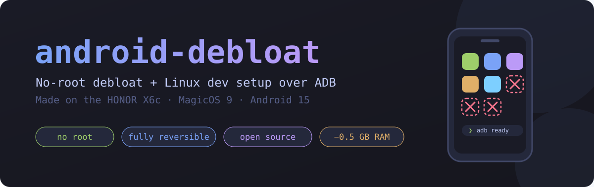
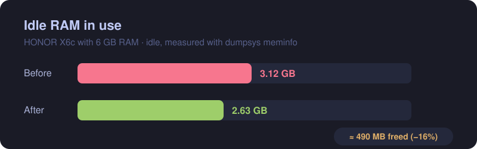
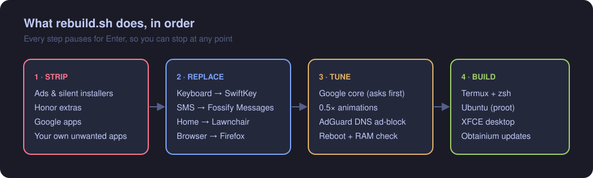
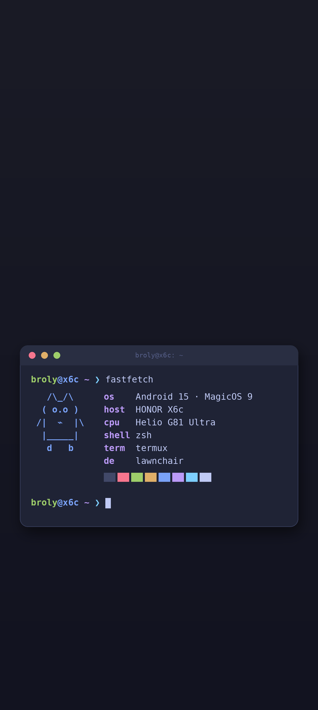

<p align="center">
  
</p>

<p align="center">
  
  
  
  
</p>

<p align="center">
  <b>Strip the ads and bloat off an HONOR phone, swap in clean open-source apps,<br>and turn it into a pocket Linux dev box, all from your computer over a USB cable.</b>
</p>

<p align="center">
  <a href="#-quick-start">Quick start</a> ·
  <a href="#-what-changes">What changes</a> ·
  <a href="#%EF%B8%8F-read-this-first">Read this first</a> ·
  <a href="#-undo-everything">Undo</a> ·
  <a href="#-faq">FAQ</a>
</p>

---

## ✨ Why

New HONOR phones ship with silent app installers, ad-filled lock screens, duplicate apps and a lot of background services you never asked for. This project:

- **Disables ~80 preinstalled apps.** Nothing is deleted, and every change can be undone with one command.
- **Replaces** the home screen, SMS app, keyboard and browser with open-source alternatives.
- **Blocks ads system-wide** with AdGuard's free Private DNS.
- **Builds a full Linux dev environment** on the phone: zsh, Python, Node, Java, C/C++, Ubuntu, even a desktop.

<p align="center">
  
</p>

## 🚀 Quick start

You need a Mac or Linux computer, a USB cable, and about 30 minutes.

**1. Install ADB on your computer**
```bash
brew install android-platform-tools      # macOS
sudo apt install android-tools-adb       # Debian / Ubuntu
```

**2. Turn on USB debugging on the phone**

Settings → About phone → tap **Build number** 7 times → back to Settings → System → Developer options → turn on **USB debugging**. Plug in the cable and tap **Allow** on the phone.

**3. Download and run**
```bash
git clone https://github.com/BRoliix/android-debloat.git
cd android-debloat
adb devices          # your phone should show as "device"
bash rebuild.sh      # walks you through every step
```

Each step waits for you to press <kbd>Enter</kbd>, so you can stop at any point with <kbd>Ctrl</kbd>+<kbd>C</kbd>.

**4. (Optional) Dev setup on the phone**

Open **Termux** on the phone and run:
```bash
termux-setup-storage
bash ~/storage/downloads/dev-setup.sh
```

## 🔄 What changes

<p align="center">
  
</p>

### Apps switched off

| List | What's in it | Count |
|---|---|:-:|
| [`batch1.txt`](lists/batch1.txt) | Ads, silent app installers (Facebook, Amazon, carrier), lock-screen magazine, "recommendations" | 26 |
| [`batch2.txt`](lists/batch2.txt) | Honor extras: App Market, Game Center, YOYO, Health, Honor Cloud, Notes, Music… | 24 |
| [`batch3.txt`](lists/batch3.txt) | Google apps: Gemini, Gmail, Maps, YouTube, Photos, Drive, Chrome… | 25 |
| [`batch4.txt`](lists/batch4.example.txt) | **Your own** apps you want gone (you fill this in) | – |
| [`batch5.txt`](lists/batch5.txt) | Google core: Play Store, Play Services (**asks first**) | 5 |
| [`batch-themes.txt`](lists/batch-themes.txt) | Honor Themes (≈167 MB RAM) | 1 |

Open any list to see each package with a plain-English comment. **Delete a line to keep that app.**

### Apps swapped in

| Instead of | You get | Why |
|---|---|---|
| Honor Launcher | [**Lawnchair**](https://github.com/LawnchairLauncher/lawnchair) + [Lawnicons](https://github.com/LawnchairLauncher/lawnicons) | Clean Pixel-style home screen, no ads or feeds |
| Google Messages | [**Fossify Messages**](https://github.com/FossifyOrg/Messages) | Works without Google |
| Honor Keyboard | **SwiftKey** | Honor's keyboard pushes ads and notifications |
| Honor Browser / Chrome | [**Firefox**](https://www.mozilla.org/firefox/mobile/) | Downloaded straight from Mozilla |
| Play Store | [**Obtainium**](https://github.com/ImranR98/Obtainium) | Updates apps straight from their GitHub releases |
| – | [Material Files](https://github.com/zhanghai/MaterialFiles) | Open-source file manager |

### Settings tweaked

- ⚡ Animations at **0.5×**, so the phone feels snappier
- 🛡️ Private DNS → **`dns.adguard-dns.com`**, which blocks ads and trackers in every app
- 🔋 Termux exempted from battery killing (no more `signal 9`)

## 💻 Pocket dev box

<table>
<tr>
<td width="300"></td>
<td>

`termux/dev-setup.sh` turns Termux into a themed Linux workstation:

- **Shell:** zsh + starship prompt, autosuggestions, syntax highlighting, Tokyo Night colours, JetBrains Mono Nerd Font
- **Languages:** Python, Node.js, Java, C/C++ (clang, make, cmake)
- **Tools:** git, gh, ssh, neovim, micro, tmux, ripgrep, fd, bat, jq
- **Ubuntu** (proot-distro) with Node 22, Docker CLI, Railway CLI and Claude Code
- **XFCE desktop** via Termux:X11, which only uses RAM while open
- **Home-screen buttons** via Termux:Widget: *Projects*, *Desktop*, *Claude*

Run `desktop` to start the Linux desktop and `ubuntu` to drop into Ubuntu.

</td>
</tr>
</table>

## ⚠️ Read this first

> [!WARNING]
> Made and tested on **one HONOR X6c** (MagicOS 9 / Android 15). Nothing is deleted, and apps are only switched off for your user. But turning off the wrong system app can break features or leave a phone stuck at boot. **Use at your own risk, and read every list before you run it.**

- **Google Play Services** (`batch5.txt`): banking apps, Google sign-in and push notifications in many apps **stop working**. The script asks for `yes` before touching it.
- **Find Device** (`batch2.txt`): this is your anti-theft lock. The two lines are marked; delete them to keep it.
- **Other phones:** apps that aren't on your phone are simply skipped, and `rebuild.sh` shows your model and asks before starting. Other HONOR / MagicOS phones are likely fine; other brands mostly won't match.

## ↩️ Undo everything

```bash
bash restore.sh          # asks before each part
bash restore.sh --all    # no questions (never removes Termux)
```

This puts the phone back to stock:

1. Switches every app in `lists/` back on (Google core first)
2. Sets the stock home screen, SMS app and keyboard back as defaults
3. Resets animations, Private DNS and the Termux tweaks
4. Offers to uninstall the swapped-in apps. Termux is asked separately, because removing it deletes everything inside it.

Need just one app back?
```bash
adb shell pm enable com.example.app
# or, if it was removed for your user:
adb shell cmd package install-existing com.example.app
```

Every run also writes a personal log to `UNDO.md` and `undo-all.sh` on your computer, with one undo command per app.

## ❓ FAQ

<details>
<summary><b>Do I need to root or unlock the bootloader?</b></summary>
<br>
No. Everything uses standard ADB commands (<code>pm disable-user</code>, <code>cmd role</code>, <code>settings put</code>). Your warranty and banking apps' root checks are unaffected.
</details>

<details>
<summary><b>Will this survive a factory reset?</b></summary>
<br>
No, a reset brings every app back. Just run <code>bash rebuild.sh</code> again.
</details>

<details>
<summary><b>Will system updates undo it?</b></summary>
<br>
Usually not, but a big MagicOS update can re-enable some apps. Re-run the list you need, e.g. <code>bash scripts/run-batch.sh lists/batch1.txt</code>.
</details>

<details>
<summary><b>I only want the ad removal, not the rest.</b></summary>
<br>
Run single steps instead of <code>rebuild.sh</code>:
<pre>bash scripts/run-batch.sh lists/batch1.txt   # ads + silent installers
bash scripts/customize.sh                    # animations, AdGuard DNS, icon pack, then a reboot</pre>
</details>

<details>
<summary><b>How do I find the package name of an app I want gone?</b></summary>
<br>
<code>adb shell pm list packages -3</code> lists apps you installed. <code>adb shell pm list packages | grep -i name</code> searches all of them. Put them in <code>lists/batch4.txt</code> (copy <code>lists/batch4.example.txt</code>).
</details>

<details>
<summary><b>Something broke after disabling an app.</b></summary>
<br>
Find it in <code>UNDO.md</code> and run its command, or run <code>bash restore.sh</code>. If the phone is stuck at boot, ADB usually still works once it shows up in <code>adb devices</code>.
</details>

## 📁 Project layout

```
rebuild.sh              ▶ start here: runs every step in order
restore.sh              ↩ puts the phone back to stock
scripts/
  run-batch.sh            disable a list of apps (logs undo commands)
  run-batch5.sh           Google core, with safety checks
  switch-keyboard.sh      SwiftKey
  install-*.sh            Fossify, Lawnchair, Firefox, Obtainium, Termux…
  customize.sh            animations, DNS, icons, reboot test, RAM check
lists/                  app lists (one package per line, with comments)
termux/dev-setup.sh     runs on the phone inside Termux
assets/                 wallpaper
docs/images/            README pictures
```

Kept on your machine only (gitignored): `apks/` downloads, `snapshots/` phone dumps, `UNDO.md` / `undo-all.sh` and `lists/batch4.txt`.

## 🙏 Credits

Built on the work of [Termux](https://github.com/termux), [Lawnchair](https://github.com/LawnchairLauncher), [Fossify](https://github.com/FossifyOrg), [Obtainium](https://github.com/ImranR98/Obtainium), [Material Files](https://github.com/zhanghai/MaterialFiles), [Mozilla](https://www.mozilla.org), [AdGuard DNS](https://adguard-dns.io), [starship](https://starship.rs) and [Tokyo Night](https://github.com/folke/tokyonight.nvim).

## 📄 License

[MIT](LICENSE). Free to use, change and share. No warranty.
